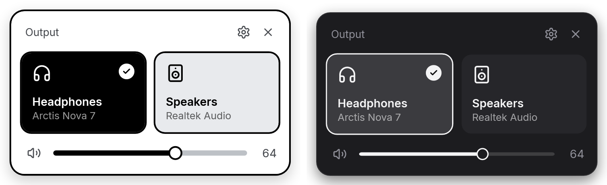

<div align="center">


# SoundSwitcher

Switch between your headphones and speakers from the Windows tray.

[**Download SoundSwitcher.exe**](https://github.com/OlfJD/Soundswitcher/releases/latest/download/SoundSwitcher.exe)

<br>



</div>

## How it works

- **Click the tray icon** to open SoundSwitcher, then click a tile to make it your output.
- **Gear icon** to pick the two devices, the theme (Stormtrooper or Dark), Start with Windows, and whether a tray click switches directly.
- **Right-click the tray icon** to exit.

It follows Windows when devices are plugged in or changed, and uses under 10 MB of memory while idle.

## Requirements

Windows 10 or 11 with the [.NET 10 Desktop Runtime](https://dotnet.microsoft.com/download/dotnet/10.0) (x64).

## Building

```bash
dotnet publish SoundSwitcher/SoundSwitcher.csproj -c Release -r win-x64 --self-contained false -p:PublishSingleFile=true
```

The app icon comes from `generate_icon.ps1`. Development notes are in [DEVLOG.md](DEVLOG.md).
